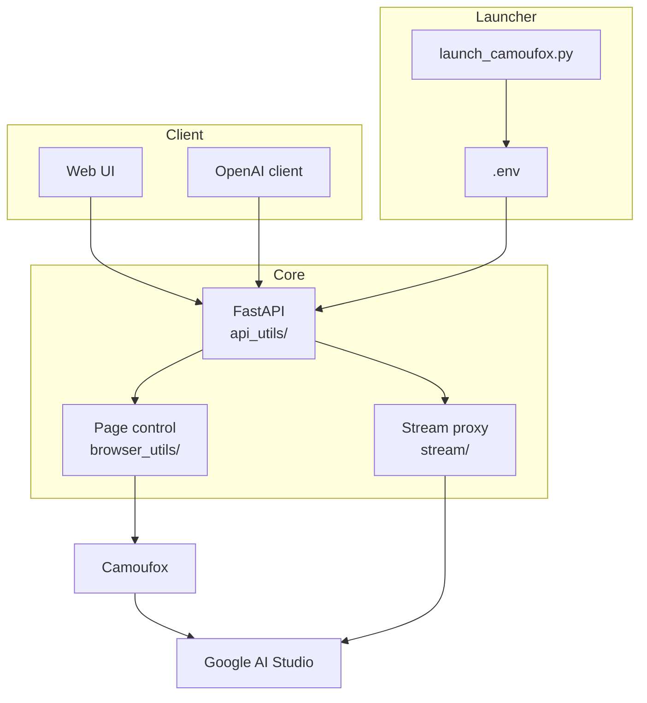

# AI Studio Proxy API — hardened fork

Turn Google AI Studio's web UI into an OpenAI-compatible API at
`http://127.0.0.1:2048/v1`, driven by Camoufox + Playwright. No API key, no
quota dashboard, no official SDK — the proxy types into the real web app and
reads the answer back.

This is a hardened fork of
[CJJackHwang/AIstudioProxyAPI](https://github.com/CJJackHwang/AIstudioProxyAPI),
tuned to sit behind an agent harness (OpenCode, Open WebUI, Cline, anything that
speaks the OpenAI chat-completions protocol). The upstream project is the
foundation; the differences are listed under
[What this fork changes](#what-this-fork-changes).

---

## Why this fork exists

The upstream proxy works as a chat relay but breaks down as an agent backend:

- requests took ~52 s;
- a tool call could be fabricated locally with `{}` arguments, without the model
  ever being asked;
- a New-chat click could hang on its own confirmation dialog and return 502;
- answering a tool call made the model re-issue the identical call.

All four are fixed here and verified end to end. `FORK-NOTES.md` records every
change with the measurements behind it.

---

## Features

- **OpenAI-compatible surface** — `/v1/chat/completions` (streaming and
  non-streaming), `/v1/models`, `/health`.
- **Always the newest Flash** — the client's `model` field is advisory; the
  proxy pins `AI_STUDIO_FORCE_MODEL` so no stale name reaches the UI.
- **Persistent chat sessions** — the AI Studio chat stays loaded between turns,
  and only the new tail is submitted when the stored transcript is a strict
  prefix of the incoming history.
- **Context rotation** — at `SESSION_CONTEXT_LIMIT_TOKENS` the chat is
  summarised, cleared, and reseeded with a `[CONTEXT HANDOFF]` block, so an
  agent session can run past a single context window.
- **Native function calling that actually works** — model-issued calls with
  real arguments, and tool results the model consumes.
- **Throttle semantics** — upstream `PERMISSION_DENIED` is reported as
  `429` with `Retry-After` instead of a hard failure.
- **Auth rotation** — profile rotation, periodic cookie refresh, and save on
  shutdown.

---

## Requirements

| Component | Requirement | Recommended |
| --- | --- | --- |
| Python | >= 3.9, < 4.0 | 3.11+ |
| Node.js | frontend build only | LTS |
| RAM | 2 GB | 4 GB+ (Camoufox is a full Firefox) |
| OS | Windows / Linux | either; Windows is what this fork is tested on |

Camoufox downloads its own Firefox build on first launch (~150 MB).

---

## Quick start

```bash
git clone https://github.com/Kaiso-666/aistudio-proxy-api.git
cd aistudio-proxy-api
python -m venv .venv
# Windows: .venv\Scripts\activate    Linux/macOS: source .venv/bin/activate
pip install -r requirements.txt
cp .env.example .env
```

### 1. Log in once

```bash
python launch_camoufox.py --debug
```

A visible browser opens. Sign into Google, then let the proxy save the session
to `auth_profiles/active/login.json`. Keep that file private — it is a live
Google session.

### 2. Run headless

```bash
python launch_camoufox.py --headless \
  --active-auth-json auth_profiles/active/login.json \
  --server-port 2048 --stream-port 3120
```

Startup takes ~50–90 s. Wait for it:

```bash
curl http://127.0.0.1:2048/health
# {"status":"OK","details":{"is_playwright_ready":true,"is_browser_connected":true,...}}
```

### 3. Talk to it

```bash
curl -X POST http://127.0.0.1:2048/v1/chat/completions \
  -H "Content-Type: application/json" \
  -d '{"model":"gemini-3.8-flash","messages":[{"role":"user","content":"hello"}]}'
```

The built-in web UI is at `http://127.0.0.1:2048/`.

---

## Client configuration

Any OpenAI-compatible client: base URL `http://127.0.0.1:2048/v1`, and any
non-empty API key — the proxy does not authenticate requests.

OpenCode (`~/.config/opencode/opencode.json`):

```json
{
  "providers": {
    "aistudio": {
      "name": "AI Studio Proxy (local)",
      "package": "@opencode/ai/providers/openai-compatible",
      "settings": {
        "baseURL": "http://127.0.0.1:2048/v1",
        "apiKey": "sk-local-proxy"
      },
      "models": {
        "gemini-3.8-flash": {
          "name": "Gemini 3.8 Flash (AI Studio, pinned)",
          "limit": { "context": 1000000, "output": 32000 }
        }
      }
    }
  }
}
```

Open WebUI: Settings → Connections → add `http://127.0.0.1:2048/v1`.

---

## Configuration

Everything lives in `.env`. The values that matter most:

| Variable | Default | Meaning |
| --- | --- | --- |
| `PORT` | `2048` | API port |
| `STREAM_PORT` | `3120` | internal stream-proxy port (`0` disables) |
| `LAUNCH_MODE` | `normal` | `headless` / `normal` / `virtual_headless` |
| `UNIFIED_PROXY_CONFIG` | empty | upstream HTTP(S) proxy, if any |
| `AUTO_ROTATE_AUTH_PROFILE` | `true` | rotate saved auth profiles |
| `AI_STUDIO_FORCE_MODEL` | `gemini-3.8-flash` | the model actually used, whatever the client asks for |
| `AI_STUDIO_MODEL_FALLBACKS` | empty | comma-separated fallbacks if the pinned model is unavailable |
| `DEFAULT_THINKING_LEVEL_FLASH` | `high` | `low` / `medium` / `high` — drives token spend |
| `DEFAULT_THINKING_LEVEL_PRO` | `high` | same, for Pro models |
| `FUNCTION_CALLING_MODE` | `auto` | `auto` (native + fallback) / `native` / `emulated` |
| `FUNCTION_CALLING_CACHE_ENABLED` | `true` | skip redundant tool-panel automation |
| `SESSION_CONTEXT_LIMIT_TOKENS` | `900000` | rotate the chat above this size |
| `HUMAN_TYPE_MAX_CHARS` | `40` | longer prompts are inserted, not typed |
| `CAMOUFOX_HUMANIZE_MAX_TIME` | `0.55` | cap on synthetic pointer travel per click |

Lower `SESSION_CONTEXT_LIMIT_TOKENS` (e.g. `150000`) to stretch a free-tier
daily quota much further; every rotation costs one summarise + clear cycle.

Full reference: [docs/configuration-reference.md](docs/configuration-reference.md)
(upstream docs — still accurate for shared settings).

---

## What this fork changes

Measured, not estimated. Details and evidence in `FORK-NOTES.md`.

| Area | Upstream | This fork |
| --- | --- | --- |
| Request latency | ~52 s | ~22 s (cached settings probe, capped humanize, bounded typing) |
| `model` field | used verbatim, can hit gated/broken names | pinned to the newest Flash; client value is advisory |
| Long sessions | full transcript re-uploaded every turn | stored prefix ⇒ delta submit only |
| Context limit | none | rotation with summarised `[CONTEXT HANDOFF]` |
| Tool calls | could be fabricated locally with `{}` args | only model-issued calls; empty-argument calls are trapped and the DOM dumped |
| Tool results | sometimes re-triggered the same call | replayed into a fresh chat so the model consumes the result |
| Upstream 403 | surfaced as failure | `429` + `Retry-After` |
| New-chat click | could hang on its own confirmation dialog → 502 | dialog-safe path with URL navigation fallback |

---

## Architecture



A request is serialised by design: one browser, one chat, one lock. Two
concurrent calls queue behind each other rather than interleaving keystrokes.

---

## Known behaviour

- **One chat clear per tool turn.** Answering a tool call inside the same native
  function-call turn makes the model re-issue the identical call, so the proxy
  replays into a fresh chat instead. Correct, and ~5 s slower than the broken
  fast path.
- **Free-tier quota is the real limit.** Roughly 1 M tokens/day plus per-model
  request buckets; the pinned model starts returning `429` when spent, and
  recovers on its own.
- **A force-killed session leaves a profile lock.** If the proxy is killed
  mid-run, delete `%TEMP%\camoufox\parent.lock` before the next start, otherwise
  Camoufox waits out its handshake timeout and dies with
  `Failed to capture WebSocket endpoint`.
- **`FUNCTION_CALLING_MODE=emulated` does not work with current models** — the
  model answers in prose without emitting a call. Keep `auto`.

---

## Development

```bash
ruff check .
pytest
```

Frontend:

```bash
cd static/frontend
npm ci && npm run build
```

## Credits

Upstream project and its authors — this fork would not exist without them:

- **Creator and lead developer**: [@CJackHwang](https://github.com/CJackHwang)
- **Core maintenance, architecture and test infrastructure**: [@NikkeTryHard](https://github.com/NikkeTryHard)
- **Feature work and page automation**: [@ayuayue](https://github.com/ayuayue)
- **Real-time streaming**: [@luispater](https://github.com/luispater)
- **Refactor contributions**: [@yattin](https://github.com/yattin)
- **Downstream maintenance**: [@MasuRii](https://github.com/MasuRii)
- **Community**: [Linux.do](https://linux.do/)

Fork maintenance: [@Kaiso-666](https://github.com/Kaiso-666).

## License

[AGPLv3](LICENSE) — inherited from upstream. If you run a modified version as a
network service, the AGPL requires you to offer its source.
