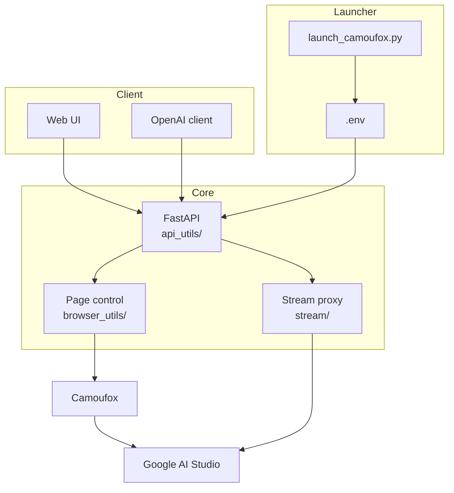

# AI Studio Proxy API — hardened fork

Turn Google AI Studio's web UI into an OpenAI-compatible API at
`http://127.0.0.1:2048/v1`, driven by Camoufox + Playwright. No API key, no
quota dashboard, no official SDK — the proxy types into the real web app and
reads the answer back.

This is a hardened fork of
[CJJackHwang/AIstudioProxyAPI](https://github.com/CJJackHwang/AIstudioProxyAPI),
tuned to sit behind an agent harness (OpenCode, Open WebUI, Cline, anything that
speaks the OpenAI chat-completions protocol). The upstream project is the
foundation; the differences are listed under
[What this fork changes](#what-this-fork-changes).

---

## Why this fork exists

The upstream proxy works as a chat relay but breaks down as an agent backend:

- requests took ~52 s;
- a tool call could be fabricated locally with `{}` arguments, without the model
  ever being asked;
- a New-chat click could hang on its own confirmation dialog and return 502;
- answering a tool call made the model re-issue the identical call.

All four are fixed here and verified end to end. `FORK-NOTES.md` records every
change with the measurements behind it.

---

## Features

- **OpenAI-compatible surface** — `/v1/chat/completions` (streaming and
  non-streaming), `/v1/models`, `/health`.
- **Model pinning** — set `AI_STUDIO_FORCE_MODEL` and the client's `model` field
  becomes advisory, so no stale or gated name reaches the UI. Unset, each request
  chooses its own model, and an unknown name is rejected with the available list
  instead of being silently swapped.
- **Persistent chat sessions** — the AI Studio chat stays loaded between turns,
  and only the new tail is submitted when the stored transcript is a strict
  prefix of the incoming history.
- **Context rotation** — at `SESSION_CONTEXT_LIMIT_TOKENS` the chat is
  summarised, cleared, and reseeded with a `[CONTEXT HANDOFF]` block, so an
  agent session can run past a single context window.
- **Native function calling that actually works** — model-issued calls with
  real arguments, and tool results the model consumes.
- **Throttle semantics** — upstream `PERMISSION_DENIED` is reported as
  `429` with `Retry-After` instead of a hard failure.
- **Auth rotation** — profile rotation, periodic cookie refresh, and save on
  shutdown.
- **Two runtimes** — launch a local Camoufox (standard), or attach to a browser
  you already run over CDP/WebSocket (Termux and headless-server setups).

---

## Requirements

| Component | Requirement | Recommended |
| --- | --- | --- |
| Python | >= 3.9, < 4.0 | 3.11+ |
| Node.js | frontend build only | LTS |
| RAM | 2 GB | 4 GB+ (Camoufox is a full Firefox) |
| OS | Windows / Linux | either; Windows is what this fork is tested on |

Camoufox downloads its own Firefox build on first launch (~150 MB).

Android/Termux cannot host Camoufox. It runs the API and attaches to a browser
you provide — see [Termux / attach mode](#termux--attach-mode).

---

## Quick start

```bash
git clone https://github.com/Kaiso-666/aistudio-proxy-api.git
cd aistudio-proxy-api
python -m venv .venv
# Windows: .venv\Scripts\activate    Linux/macOS: source .venv/bin/activate
pip install -r requirements.txt
cp .env.example .env
```

### 1. Log in once

```bash
python launch_camoufox.py --debug
```

A visible browser opens. Sign into Google, then let the proxy save the session
to `auth_profiles/active/login.json`. Keep that file private — it is a live
Google session.

### 2. Run headless

```bash
python launch_camoufox.py --headless \
  --active-auth-json auth_profiles/active/login.json \
  --server-port 2048 --stream-port 3120
```

Startup takes ~50–90 s. Wait for it:

```bash
curl http://127.0.0.1:2048/health
# {"status":"OK","details":{"is_playwright_ready":true,"is_browser_connected":true,...}}
```

### 3. Talk to it

```bash
curl -X POST http://127.0.0.1:2048/v1/chat/completions \
  -H "Content-Type: application/json" \
  -d '{"model":"gemini-3.8-flash","messages":[{"role":"user","content":"hello"}]}'
```

The built-in web UI is at `http://127.0.0.1:2048/`.

---

## Termux / attach mode

`launch_camoufox.py` starts a local Camoufox: a glibc Firefox build, which
Android cannot host. Attach mode inverts the relationship — you run the browser,
the proxy connects to it.

On any host that has Playwright (Linux, macOS, Windows, or Debian inside proot):

```bash
# a Chromium on the device (or reachable over the network)
chromium --headless=new --remote-debugging-port=9222 about:blank &

python launch_camoufox.py --termux --server-port 2048
```

Or point it at a browser on another machine (Camoufox and Chromium both work):

```bash
python launch_camoufox.py --termux \
  --browser-endpoint ws://desktop.local:9222/devtools/browser/<id>
```

### On-device setup (Termux + proot Debian)

Native Termux cannot run the proxy: `pip` has no Playwright wheel for bionic
(`No matching distribution found for playwright` — the driver is a glibc
binary), and Camoufox is glibc too. A Debian container under `proot-distro` is
regular Linux, so everything installs and runs there; the repo is visible at
the same path.

| | standard | termux / attach |
| --- | --- | --- |
| browser process | launched by this repo | yours, started beforehand |
| connector | Playwright `firefox.connect` | `chromium.connect_over_cdp` (`http://` endpoint) or `connect` (`ws://`) |
| `STREAM_PORT` | `3120` (MITM fast path) | `0` unless you pass `--stream-port` |
| startup check | requires `camoufox` importable | requires nothing but an endpoint |

```bash
pkg install proot-distro
proot-distro install debian
# once, inside the container: python3, chromium, venv, dependencies
proot-distro login debian -- bash ~/aistudio-proxy-api/tools/termux/bootstrap-debian.sh
# every run: starts Chromium on :9222 and the proxy on :2048
bash tools/termux/start.sh
```

`bootstrap-debian.sh` forces IPv4 for apt (inside proot, DNS resolves to IPv6
that has no route, which fails as "Temporary failure resolving deb.debian.org")
and does **not** run `playwright install`: attach mode needs the driver, not
Playwright's bundled browsers.

First sign-in, once, without leaving the phone:

```bash
bash tools/termux/login-on-device.sh
# VNC on 127.0.0.1:5900 (pkg install tigervnc; vncviewer 127.0.0.1:5900)
# sign in to Google in the AI Studio window, press Enter here
# -> cookies saved to auth_profiles/saved/login.json
bash tools/termux/start.sh --active-auth-json auth_profiles/saved/login.json
```

The login run needs a terminal: without a TTY the proxy now refuses with
"Authentication required … pass --active-auth-json" instead of dying on
`EOF when reading a line`.

What changes and why:

- **No local launch, no Camoufox dependency.** The dependency check is skipped:
  attaching does not need the package, only Playwright's driver.
- **The MITM fast path is off by default.** The stream proxy only sees traffic
  from a browser configured to use it as its proxy, and your browser is not. With
  `STREAM_PORT=0` the proxy uses the Playwright/DOM path: correct output, but
  TTFB is the whole generation instead of the first frame. Pass `--stream-port`
  if you *do* route the browser through it.
- **`/health` says which mode is live** — `runtime.mode`,
  `runtime.browser.kind`, `runtime.browser.connected`.
- **A wrong endpoint fails fast.** `http://` endpoints are probed at
  `/json/version` before startup, so a wrong port or a browser bound to
  `127.0.0.1` on another host is an error with the command to fix it, not a 30 s
  Playwright timeout. `BROWSER_SKIP_PROBE=1` starts anyway.

What it does not do: make Playwright's driver run on Android. Native Termux
still cannot run the proxy — attach mode removes the local *browser* requirement,
not the driver. Use the proot container above, or run the proxy on another host
and point it at a remote browser with `BROWSER_WS_ENDPOINT`.

Verified on this device: `proot-distro install debian` → Python 3.13, Chromium
156, `chromium.connect_over_cdp` from Playwright 1.62 connects and loads pages,
and the proxy attaches, creates its context, navigates to AI Studio, and reports
the auth state. The Google sign-in itself is the one step that needs a human
(VNC or a copied `login.json`).

---

## Client configuration

Any OpenAI-compatible client: base URL `http://127.0.0.1:2048/v1`, and any
non-empty API key — the proxy does not authenticate requests.

OpenCode (`~/.config/opencode/opencode.json`):

```json
{
  "providers": {
    "aistudio": {
      "name": "AI Studio Proxy (local)",
      "package": "@opencode/ai/providers/openai-compatible",
      "settings": {
        "baseURL": "http://127.0.0.1:2048/v1",
        "apiKey": "sk-local-proxy"
      },
      "models": {
        "gemini-3.8-flash": {
          "name": "Gemini 3.8 Flash (AI Studio, pinned)",
          "limit": { "context": 1000000, "output": 32000 }
        }
      }
    }
  }
}
```

Open WebUI: Settings → Connections → add `http://127.0.0.1:2048/v1`.

---

## Configuration

Everything lives in `.env`. The values that matter most:

| Variable | Default | Meaning |
| --- | --- | --- |
| `PORT` | `2048` | API port |
| `STREAM_PORT` | `3120` | internal stream-proxy port (`0` disables) |
| `LAUNCH_MODE` | `normal` | `headless` / `normal` / `virtual_headless` |
| `RUNTIME_MODE` | `standard` | `standard` launches Camoufox; `termux` attaches to an existing browser; `auto` detects Termux |
| `BROWSER_CDP_ENDPOINT` | empty | Chromium CDP endpoint to attach to (`http://127.0.0.1:9222`) |
| `BROWSER_WS_ENDPOINT` | empty | Playwright WebSocket endpoint to attach to (Camoufox on another host) |
| `UNIFIED_PROXY_CONFIG` | empty | upstream HTTP(S) proxy, if any |
| `AUTO_ROTATE_AUTH_PROFILE` | `true` | rotate saved auth profiles |
| `AI_STUDIO_FORCE_MODEL` | unset | pin the model actually used; unset / `off` lets each request choose |
| `AI_STUDIO_MODEL_FALLBACKS` | empty | comma-separated fallbacks if the pinned model is unavailable |
| `DEFAULT_THINKING_LEVEL_FLASH` | `high` | `low` / `medium` / `high` — drives token spend |
| `DEFAULT_THINKING_LEVEL_PRO` | `high` | same, for Pro models |
| `FUNCTION_CALLING_MODE` | `auto` | `auto` (native + fallback) / `native` / `emulated` |
| `FUNCTION_CALLING_CACHE_ENABLED` | `true` | skip redundant tool-panel automation |
| `SESSION_CONTEXT_LIMIT_TOKENS` | `900000` | rotate the chat above this size |
| `HUMAN_TYPE_MAX_CHARS` | `320` | longer prompts are inserted instead of typed |
| `CAMOUFOX_HUMANIZE_MAX_TIME` | `0.55` | cap on synthetic pointer travel per click |
| `STREAM_INTERSTREAM_DELAY_S` | `0` | gap forced between back-to-back streaming turns (`0` = none) |
| `MAX_QUEUE_DEPTH` | `3` | reject with `429` + `Retry-After` past this queue depth (`0` disables) |
| `RPC_CAPTURE_LIMIT` | `25` | capture this many outgoing `GenerateContent` bodies to `logs/rpc/` (`0` disables) |
| `TURN_TIMING` | `0` | one INFO line per turn: queue / prep / TTFB / generation / tail |

Lower `SESSION_CONTEXT_LIMIT_TOKENS` (e.g. `150000`) to stretch a free-tier
daily quota much further; every rotation costs one summarise + clear cycle.

Full reference: [docs/configuration-reference.md](docs/configuration-reference.md)
(upstream docs — still accurate for shared settings).

### Fields this transport cannot honour

Returned as `400` with the reason, rather than accepted and ignored — a `200`
for a request the proxy did not actually perform is worse than an error:

| Field | Why |
| --- | --- |
| `n > 1` | one generation per turn |
| `logprobs`, `top_logprobs` | the web client exposes no logit data |
| `presence_penalty`, `frequency_penalty` | no penalty control exists in AI Studio; faking it via temperature would change the request |
| `parallel_tool_calls: false` | the model decides how many calls to emit |

`max_tokens`, `max_completion_tokens` and `max_output_tokens` are the same knob
and are accepted interchangeably.

`response_format` is the one field handled rather than refused: the page cannot
do grammar-constrained decoding, but it can be told, so `json_object` /
`json_schema` is translated into an instruction block at the top of the prompt
(schema included). A non-streaming reply that is nothing but a single ```json
fence is unwrapped before it reaches the client, because a strict parser would
otherwise reject a correct answer. It is *instructed*, not enforced: the
streaming path cannot retract a fence it has already sent.

### `/health`

Besides readiness it reports `session` (reuse enabled, rotation limit, and per
session turn/page counters — if this keeps saying `sessions: 0` an agent loop is
paying a full transcript replay every turn) and `timing` (phase medians for the
last 20 turns).

---

## What this fork changes

Measured, not estimated. Details and evidence in `FORK-NOTES.md`; the later work
that is reasoned but not yet measured is kept separate, in
[OPTIMIZATION.md](OPTIMIZATION.md), with the RPC plan in
[docs/architecture/RPC-MODE.md](docs/architecture/RPC-MODE.md).

| Area | Upstream | This fork |
| --- | --- | --- |
| Request latency | ~52 s | ~22 s (cached settings probe, capped humanize, bounded typing) |
| `model` field | used verbatim, can hit gated/broken names | pinnable via `AI_STUDIO_FORCE_MODEL`; unknown names are `400` with the available list |
| Long sessions | full transcript re-uploaded every turn | stored prefix ⇒ delta submit only |
| Context limit | none | rotation with summarised `[CONTEXT HANDOFF]` |
| Tool calls | could be fabricated locally with `{}` args | only model-issued calls; empty-argument calls are trapped and the DOM dumped |
| Tool results | sometimes re-triggered the same call | replayed into a fresh chat so the model consumes the result |
| Upstream 403 | surfaced as failure | `429` + `Retry-After` |
| New-chat click | could hang on its own confirmation dialog → 502 | dialog-safe path with URL navigation fallback |
| Stream cut by a timeout | reported `finish_reason: "stop"` | `"length"`, session invalidated, `502` when non-streaming |
| `response_format` | accepted, echoed back, ignored | translated into a prompt instruction; non-streaming JSON fences unwrapped |

---

## Architecture



A request is serialised by design: one browser, one chat, one lock. Two
concurrent calls queue behind each other rather than interleaving keystrokes.

In attach mode the `Camoufox` box is a browser you run yourself; the proxy
reaches it over CDP or WebSocket instead of spawning it (see
[Termux / attach mode](#termux--attach-mode)).

---

## Known behaviour

- **One chat clear per tool turn.** Answering a tool call inside the same native
  function-call turn makes the model re-issue the identical call, so the proxy
  replays into a fresh chat instead. Correct, and ~5 s slower than the broken
  fast path.
- **Free-tier quota is the real limit.** Roughly 1 M tokens/day plus per-model
  request buckets; the pinned model starts returning `429` when spent, and
  recovers on its own.
- **A force-killed session leaves a profile lock.** If the proxy is killed
  mid-run, delete `%TEMP%\camoufox\parent.lock` before the next start, otherwise
  Camoufox waits out its handshake timeout and dies with
  `Failed to capture WebSocket endpoint`.
- **A turn cut by the transport is not reported as a complete answer.** Silence,
  TTFB and hard timeouts, and a zombie takeover, all end a turn early. The final
  chunk then says `finish_reason: "length"` (non-streaming returns `502`), the
  internal status token never leaks into `reasoning_content`, and the chat session
  is invalidated so the next turn replays instead of submitting a transcript the
  page already holds in full. `zombie_stream_aborted` reports `length` but keeps
  the session: the page already belongs to a successor request.
- **`emulated` function calling does not work with current models** — the model
  answers in prose without emitting a call. Keep `auto`.

---

## Development

```bash
poetry run ruff check .
poetry run pyright
poetry run pytest                      # needs the project venv
python3 tools/check_stream_decoder.py  # wire decoder, stdlib only
```

`tools/check_stream_decoder.py` replays gzip/chunked response bodies in
cumulative one-byte reads and asserts exact text — run it after any change under
`stream/`, where a frame-boundary regression is otherwise invisible until a
client reports a cut answer. `tools/inspect_rpc_capture.py` decodes captured
`GenerateContent` request bodies (`RPC_CAPTURE_LIMIT`) offline.

Contributions: [`CONTRIBUTING.md`](CONTRIBUTING.md) — which checks gate a change,
and why measured and reasoned work are kept in separate files.

Frontend:

```bash
cd static/frontend
npm ci && npm run build
```

## Credits

Upstream project and its authors — this fork would not exist without them:

- **Creator and lead developer**: [@CJackHwang](https://github.com/CJackHwang)
- **Core maintenance, architecture and test infrastructure**: [@NikkeTryHard](https://github.com/NikkeTryHard)
- **Feature work and page automation**: [@ayuayue](https://github.com/ayuayue)
- **Real-time streaming**: [@luispater](https://github.com/luispater)
- **Refactor contributions**: [@yattin](https://github.com/yattin)
- **Downstream maintenance**: [@MasuRii](https://github.com/MasuRii)
- **Community**: [Linux.do](https://linux.do/)

Fork maintenance: [@Kaiso-666](https://github.com/Kaiso-666).

## License

[AGPLv3](LICENSE) — inherited from upstream. If you run a modified version as a
network service, the AGPL requires you to offer its source.
